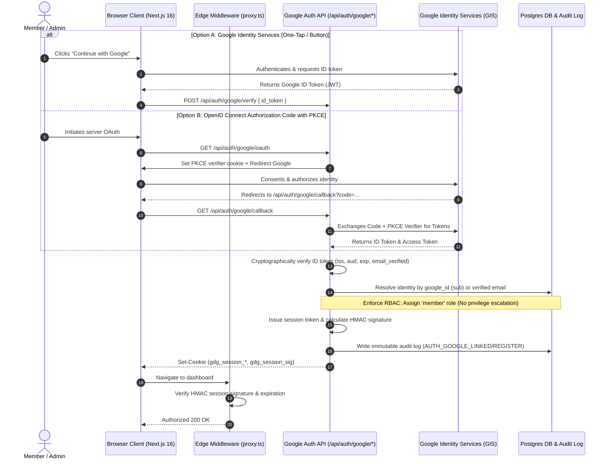

# 🔐 Platform Authentication Architecture & Identity Federation

## 1. System Overview
The **GDG on Campus NCTU HR Management Platform** enforces a defense-in-depth identity and access governance architecture. It integrates federated Google Sign-In (OpenID Connect / OAuth 2.0 PKCE) with the platform's role-based authorization and cryptographically signed session management.

---

## 2. Cryptographic ID Token Verification Engine

Token verification is executed on the server inside [`src/lib/google-auth.ts`](file:///c:/Users/Hossam%20Ahmed/Documents/Project/hr-management-platform/src/lib/google-auth.ts) using Google's official `google-auth-library`.

### Strict Validation Requirements:
1. **Cryptographic Signature:** Verified against Google's public JSON Web Key Sets (JWKS) (`https://www.googleapis.com/oauth2/v3/certs`).
2. **Issuer Verification:** Strict enforcement of trusted issuer: `accounts.google.com` or `https://accounts.google.com`.
3. **Audience Check:** Matches configured `GOOGLE_CLIENT_ID` exactly. Prevents confused deputy attacks where a token created for another application is submitted.
4. **Expiration Time:** `exp` claim must be in the future.
5. **Verified Email:** `email_verified` must be `true`. Accounts with unverified emails are rejected immediately.
6. **Immutable Subject (`sub`):** The verified Google `sub` identifier is used as the external primary key, preventing account mix-ups if a user updates their email.

---

## 3. Account Linking & Privilege Escalation Defense

### Explicit Account Linking Rules
- **Rule 1 — Matched `google_id`:** If a profile with the verified `sub` exists, verify account status. If active, log the user in immediately.
- **Rule 2 — Matched Verified Email:** If no profile has this `sub`, but a profile exists with the exact verified email:
  - Check account status: if `suspended`, `inactive`, or `archived`, reject login (`ACCOUNT_SUSPENDED` / `ACCOUNT_INACTIVE`).
  - Link `google_id = sub` onto the existing record.
  - Retain the user's existing role, permissions, and team associations.
- **Rule 3 — New Google Account (Zero Privilege Escalation):**
  - If database is clean and empty (first boot): the very first Google user is initialized as `super_admin` for system bootstrap.
  - If database is NOT empty: new Google users are **strictly assigned the default `member` role**.
  - **Security Mandate:** No administrative roles (`super_admin`, `hr_admin`, `team_lead`) can ever be granted automatically through Google email domains, headers, or client payloads. Privileged roles require explicit administrative elevation.

---

## 4. Session Architecture & Edge Proxy Verification

Session tokens and signatures are unified between browser storage and server edge middleware:

### Cookie Specification:
- `gdg_session_role`: User role (`super_admin`, `hr_admin`, `member`, etc.)
- `gdg_session_user`: User UUID
- `gdg_session_expires`: Expiration timestamp in milliseconds (24h persistent, 8h standard)
- `gdg_auth_token`: Cryptographically random session entropy token (`session_...`)
- `gdg_session_sig`: Deterministic HMAC signature generated by:
  $$\text{HMAC-SHA256}(\text{SESSION\_SECRET}, \text{userId} : \text{role} : \text{token})$$

### Edge Middleware Enforcement ([`src/proxy.ts`](file:///c:/Users/Hossam%20Ahmed/Documents/Project/hr-management-platform/src/proxy.ts))
1. Validates `gdg_session_expires`: Automatically redirects expired sessions to `/login?reason=expired` and clears cookies.
2. Validates administrative access: Restricts `/audit-log` strictly to `super_admin` and `hr_admin`.
3. Prevents client-side role tampering: Any modification to `gdg_session_role` invalidates the signature and blocks access.
