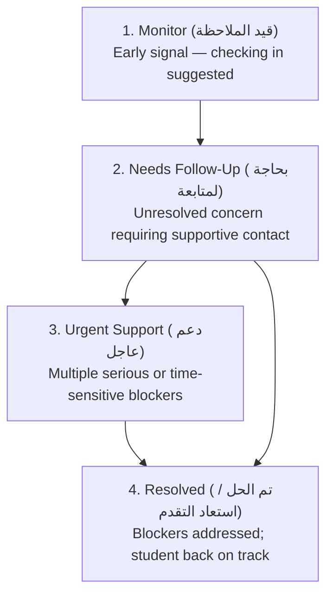
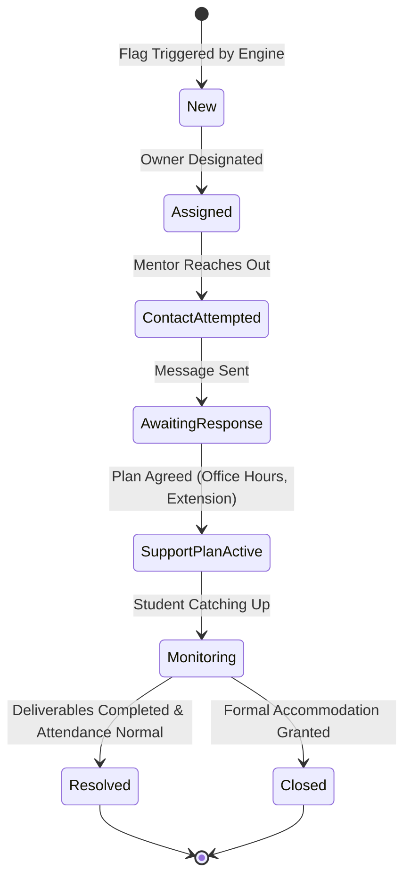

# At-Risk Students Monitoring & Follow-Up System Specification
**Project:** GDG on Campus NCTU HR Management Platform  
**Subsystem:** Technical Tracks Management — Early Intervention & Support Engine  
**Status:** Implemented & Fully Operational  

---

## 1. Objective & Non-Punitive Core Principle
The At-Risk Students Monitoring and Follow-Up module is an early-support system designed to identify participants who may be struggling to complete their technical track milestones.

> [!IMPORTANT]
> **Ethical Principle:** A risk flag is strictly a signal to review and offer personalized academic support. It is **never** proof of misconduct, lack of commitment, or automatic grounds for removal. Risk information is strictly restricted to authorized staff and mentors.

---

## 2. Configurable Risk Indicators & Trigger Rules

| Rule ID | Rule Name | Trigger Condition | Default Threshold | Severity | Recommended Intervention |
|---|---|---|---|---|---|
| `risk_att_low` | Attendance Below 75% | Attendance Rate < Threshold | 75% | `needs_follow_up` | Schedule 1-on-1 check-in to identify scheduling/exam conflicts. |
| `risk_abs_consec` | Consecutive Unexcused Absences | Consecutive unexcused absences | 2 sessions | `urgent_support` | Direct supportive contact via mentor or HR to verify student well-being. |
| `risk_asg_missing` | Missing Track Deliverables | Unsubmitted overdue assignments | 2 deliverables | `urgent_support` | Review technical blockers and offer office hours or lab assistance. |
| `risk_asg_comp_low` | Deliverables Completion Below 60% | Completed / Total Assignments | 60% | `needs_follow_up` | Clarify rubric criteria and provide starter templates. |
| `risk_resub_overdue` | Resubmission Deadline Exceeded | Requested revisions past deadline | 1 assignment | `needs_follow_up` | Check in regarding revision feedback clarity and extend deadline if needed. |

---

## 3. Risk Levels
The system uses an explainable, 4-tier risk classification:

- **Explainability:** No opaque machine-learning scoring. Every participant flag shows exact transparent evidence (e.g., *"2 consecutive unexcused absences recorded"* or *"Attendance completion rate is 50% (threshold: 75%)"*).

---

## 4. Fair Context & Accommodations Guardrails
Before evaluating any risk indicator, the system enforces fairness rules:
1. **Excused Absences:** Sessions marked with status `excused` are never counted as unexcused absences or used to trigger consecutive absence flags.
2. **Approved Deadline Extensions:** Assignments with a valid `deadline_extension_date` in the future are never counted as overdue.
3. **Pending Instructor Grading:** Submissions awaiting grading are never penalized as missing deliverables.
4. **Cancelled Sessions:** Cancelled track sessions are excluded from the attendance denominator.

---

## 5. Follow-Up Case Management Workflow

### Supported Support Action Types:
- `office_hours_mentor`: Dedicated 1-on-1 tutoring or lab code review.
- `clarify_requirements`: Explaining instructions, starter repos, and rubric expectations.
- `supportive_reminder`: Non-threatening WhatsApp/Email check-in.
- `workload_extension`: Reviewing academic conflicts and granting a formal deadline extension.
- `technical_blocker`: Addressing hardware, environment, or SDK installation issues.
- `additional_learning_resources`: Providing targeted tutorials and documentation.

---

## 6. Duplicate Prevention & Automatic Sync
- When background evaluation runs, participants triggering risk rules are matched against open cases for that track (`status != 'resolved' AND status != 'closed'`).
- If an open case already exists, the engine **updates the existing case** with fresh indicators and does **not** create a duplicate ticket.
- When an issue is resolved, updating status to `resolved` timestamps the resolution date and suppresses further at-risk notifications.
