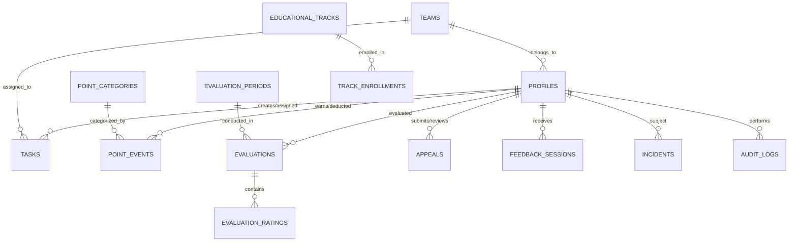

# GDG on Campus NCTU — Relational Data Model & Schema Specification

**System:** GDG NCTU HR Management Platform  
**Database Engine:** PostgreSQL 15+ on Supabase  
**Document Reference:** `DB-SCHEMA-2026-V2`  

---

## 1. Entity-Relationship Overview



---

## 2. Core Relational Tables Specification

### 1. `profiles` (User Accounts & Roles)
```sql
CREATE TABLE profiles (
    id UUID PRIMARY KEY REFERENCES auth.users(id) ON DELETE CASCADE,
    email TEXT UNIQUE NOT NULL,
    full_name TEXT NOT NULL,
    name_ar TEXT,
    avatar_url TEXT,
    role TEXT NOT NULL CHECK (role IN (
        'super_admin', 'hr_admin', 'hr_reviewer', 'team_lead',
        'member', 'track_lead', 'lead_instructor', 'ta_mentor', 'attendee'
    )),
    team_id UUID REFERENCES teams(id) ON DELETE SET NULL,
    committee TEXT,
    status TEXT NOT NULL DEFAULT 'active' CHECK (status IN ('active', 'inactive', 'suspended', 'archived', 'alumni')),
    onboarding_status TEXT DEFAULT 'pending' CHECK (onboarding_status IN ('pending', 'in_progress', 'completed')),
    join_date TIMESTAMPTZ DEFAULT NOW(),
    phone TEXT,
    academic_notes TEXT,
    created_at TIMESTAMPTZ DEFAULT NOW(),
    updated_at TIMESTAMPTZ DEFAULT NOW()
);
```

### 2. `teams` (Committees & Technical Tracks)
```sql
CREATE TABLE teams (
    id UUID PRIMARY KEY DEFAULT gen_random_uuid(),
    name TEXT NOT NULL,
    name_ar TEXT NOT NULL,
    description TEXT,
    type TEXT NOT NULL CHECK (type IN ('technical', 'non_technical')),
    lead_id UUID REFERENCES profiles(id) ON DELETE SET NULL,
    status TEXT NOT NULL DEFAULT 'active' CHECK (status IN ('active', 'archived')),
    created_at TIMESTAMPTZ DEFAULT NOW(),
    updated_at TIMESTAMPTZ DEFAULT NOW()
);
```

### 3. `tasks` & `task_assignees` (Task Management)
```sql
CREATE TABLE tasks (
    id UUID PRIMARY KEY DEFAULT gen_random_uuid(),
    team_id UUID REFERENCES teams(id) ON DELETE CASCADE,
    title TEXT NOT NULL,
    description TEXT NOT NULL,
    priority TEXT NOT NULL CHECK (priority IN ('low', 'medium', 'high', 'urgent')),
    status TEXT NOT NULL DEFAULT 'assigned' CHECK (status IN (
        'draft', 'assigned', 'in_progress', 'blocked', 'submitted', 'needs_revision', 'completed', 'cancelled'
    )),
    deadline TIMESTAMPTZ NOT NULL,
    acceptance_criteria TEXT NOT NULL,
    deliverable_link TEXT,
    created_by UUID NOT NULL REFERENCES profiles(id),
    created_at TIMESTAMPTZ DEFAULT NOW(),
    updated_at TIMESTAMPTZ DEFAULT NOW()
);

CREATE TABLE task_assignees (
    id UUID PRIMARY KEY DEFAULT gen_random_uuid(),
    task_id UUID NOT NULL REFERENCES tasks(id) ON DELETE CASCADE,
    profile_id UUID NOT NULL REFERENCES profiles(id) ON DELETE CASCADE,
    assigned_at TIMESTAMPTZ DEFAULT NOW(),
    UNIQUE(task_id, profile_id)
);
```

### 4. `point_events` & `point_cap_categories` (Points Ledger)
```sql
CREATE TABLE point_cap_categories (
    id TEXT PRIMARY KEY,
    name TEXT NOT NULL,
    name_ar TEXT NOT NULL,
    points_per_event NUMERIC(4, 2) NOT NULL,
    monthly_cap NUMERIC(4, 2) NOT NULL,
    is_active BOOLEAN DEFAULT TRUE,
    created_at TIMESTAMPTZ DEFAULT NOW()
);

CREATE TABLE point_events (
    id UUID PRIMARY KEY DEFAULT gen_random_uuid(),
    member_id UUID NOT NULL REFERENCES profiles(id) ON DELETE CASCADE,
    team_id UUID REFERENCES teams(id) ON DELETE SET NULL,
    category_id TEXT NOT NULL,
    cap_category_id TEXT REFERENCES point_cap_categories(id),
    value NUMERIC(4, 2) NOT NULL,
    direction TEXT NOT NULL CHECK (direction IN ('positive', 'negative')),
    status TEXT NOT NULL DEFAULT 'approved' CHECK (status IN ('pending_review', 'approved', 'rejected', 'disputed', 'reversed')),
    evidence_url TEXT NOT NULL,
    explanation TEXT NOT NULL,
    created_by UUID NOT NULL REFERENCES profiles(id),
    reviewer_id UUID REFERENCES profiles(id),
    reviewed_at TIMESTAMPTZ,
    reversal_reason TEXT,
    historical_approval_verified BOOLEAN DEFAULT TRUE,
    created_at TIMESTAMPTZ DEFAULT NOW(),
    updated_at TIMESTAMPTZ DEFAULT NOW()
);
```

### 5. `evaluations` & `evaluation_ratings` (Monthly Reviews)
```sql
CREATE TABLE evaluations (
    id UUID PRIMARY KEY DEFAULT gen_random_uuid(),
    member_id UUID NOT NULL REFERENCES profiles(id) ON DELETE CASCADE,
    evaluator_id UUID NOT NULL REFERENCES profiles(id),
    period_id TEXT NOT NULL,
    template_id TEXT NOT NULL DEFAULT 'tpl-default',
    total_score NUMERIC(5, 2),
    performance_band TEXT CHECK (performance_band IN (
        'Outstanding Performance', 'Strong Performance', 'Needs Improvement', 'Coaching and Guidance', 'Not Evaluated'
    )),
    status TEXT NOT NULL DEFAULT 'draft' CHECK (status IN ('draft', 'submitted', 'finalized', 'amended')),
    feedback TEXT,
    strengths TEXT,
    development_areas TEXT,
    support_required TEXT,
    follow_up_date DATE,
    amendment_reason TEXT,
    policy_version_id TEXT DEFAULT 'v1.0.0',
    created_at TIMESTAMPTZ DEFAULT NOW(),
    updated_at TIMESTAMPTZ DEFAULT NOW(),
    UNIQUE(member_id, period_id)
);

CREATE TABLE evaluation_ratings (
    id UUID PRIMARY KEY DEFAULT gen_random_uuid(),
    evaluation_id UUID NOT NULL REFERENCES evaluations(id) ON DELETE CASCADE,
    category_id TEXT NOT NULL,
    rating INTEGER CHECK (rating >= 1 AND rating <= 5),
    is_na BOOLEAN DEFAULT FALSE,
    comments TEXT,
    UNIQUE(evaluation_id, category_id)
);
```

### 6. `appeals` & `incidents` (Grievances & Escalation)
```sql
CREATE TABLE appeals (
    id UUID PRIMARY KEY DEFAULT gen_random_uuid(),
    member_id UUID NOT NULL REFERENCES profiles(id) ON DELETE CASCADE,
    related_type TEXT NOT NULL CHECK (related_type IN ('point_event', 'evaluation')),
    related_id TEXT NOT NULL,
    reason TEXT NOT NULL,
    evidence_url TEXT,
    deadline TIMESTAMPTZ NOT NULL,
    status TEXT NOT NULL DEFAULT 'submitted' CHECK (status IN ('submitted', 'under_review', 'upheld', 'adjusted', 'dismissed')),
    reviewer_id UUID REFERENCES profiles(id),
    verdict_notes TEXT,
    reviewed_at TIMESTAMPTZ,
    created_at TIMESTAMPTZ DEFAULT NOW(),
    updated_at TIMESTAMPTZ DEFAULT NOW()
);

CREATE TABLE incidents (
    id UUID PRIMARY KEY DEFAULT gen_random_uuid(),
    member_id UUID NOT NULL REFERENCES profiles(id) ON DELETE CASCADE,
    level INTEGER NOT NULL CHECK (level IN (1, 2, 3, 4)),
    title TEXT NOT NULL,
    description TEXT NOT NULL,
    evidence_url TEXT,
    action_plan TEXT,
    follow_up_date DATE,
    status TEXT NOT NULL DEFAULT 'open' CHECK (status IN ('open', 'monitoring', 'resolved', 'escalated')),
    created_by UUID NOT NULL REFERENCES profiles(id),
    created_at TIMESTAMPTZ DEFAULT NOW(),
    updated_at TIMESTAMPTZ DEFAULT NOW()
);
```

### 7. `audit_logs` (Immutable Audit Ledger)
```sql
CREATE TABLE audit_logs (
    id UUID PRIMARY KEY DEFAULT gen_random_uuid(),
    actor_id UUID REFERENCES profiles(id) ON DELETE SET NULL,
    action TEXT NOT NULL,
    target_type TEXT NOT NULL,
    target_id TEXT NOT NULL,
    details JSONB,
    ip_address TEXT,
    created_at TIMESTAMPTZ DEFAULT NOW()
);
```
