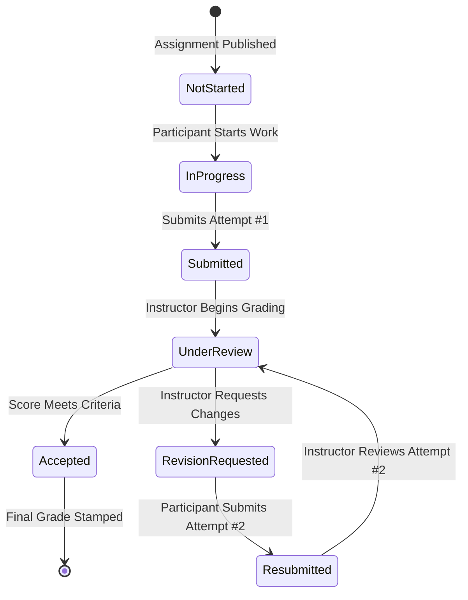

# Assignment Feedback, Resubmission & Attempt History Specification
**Project:** GDG on Campus NCTU HR Management Platform  
**Subsystem:** Technical Tracks Management — Evaluation & Resubmission Engine  
**Status:** Implemented & Fully Operational  

---

## 1. Objective & Philosophy
The Assignment Feedback and Resubmission subsystem provides a complete, structured review workflow so instructors can evaluate deliverables, provide actionable constructive guidance, request revisions, and preserve every submission attempt without losing previous grades or versions.

Critical Design Principles:
1. **Immutable History:** Earlier attempts are never overwritten when a participant resubmits.
2. **Supportive Revision:** Requesting revisions is not treated as a punitive failure; it is part of the iterative learning process.
3. **Auditability:** Any post-publication grade correction is strictly logged with actor, timestamp, and documented rationale.
4. **Configurable Policies:** Final score calculation strictly respects the assignment's approved policy (`highest_approved`, `latest_reviewed`, `instructor_selected`).

---

## 2. Submission & Review Lifecycle



### Supported Status Definitions:
- `not_started`: Deliverable not yet initiated.
- `in_progress`: Participant active on project.
- `submitted`: Deliverable submitted before deadline.
- `submitted_late`: Deliverable submitted after deadline without approved extension.
- `under_review`: Instructor reviewing deliverable.
- `revision_requested`: Instructor requested specific corrections with an optional resubmission deadline.
- `resubmitted`: Participant delivered a subsequent attempt addressing requested changes.
- `accepted`: Deliverable accepted and officially graded.
- `excused`: Student excused from milestone due to verified academic/health accommodations.
- `cancelled`: Assignment officially cancelled.

---

## 3. Structured Feedback Architecture
Instructors evaluate submissions using multi-field structured feedback to guarantee constructive clarity:

```typescript
export interface StructuredFeedback {
  what_went_well: string;                  // Strengths, architectural patterns, design highlights
  needs_improvement: string;              // Bugs, edge cases, responsive layout problems
  specific_corrections: string;           // Direct action items and files to modify
  required_changes_for_acceptance: string;// Strict blockers required before acceptance
  learning_resources?: string;            // Documentation links, articles, official guides
  suggested_next_steps?: string;          // Recommendations for capstone or advanced practice
  rubric_scores?: Record<string, number>; // Rubric criterion scores if configured
}
```

---

## 4. Immutable Attempt History Model
Every attempt is recorded as a distinct, immutable row in `track_submission_attempts`:

```sql
CREATE TABLE track_submission_attempts (
  id VARCHAR(64) PRIMARY KEY,
  submission_id VARCHAR(64) REFERENCES track_submissions(id),
  assignment_id VARCHAR(64) REFERENCES track_assignments(id),
  enrollment_id VARCHAR(64) REFERENCES track_enrollments(id),
  participant_id VARCHAR(64) REFERENCES participants(id),
  attempt_number INT NOT NULL,
  submission_url TEXT NOT NULL,
  submitted_at TIMESTAMPTZ NOT NULL,
  applicable_deadline TIMESTAMPTZ NOT NULL,
  is_late BOOLEAN DEFAULT FALSE,
  late_penalty_applied INT DEFAULT 0,
  status VARCHAR(32) NOT NULL,
  score NUMERIC(5,2),
  feedback JSONB,
  reviewer_id VARCHAR(64),
  reviewer_name VARCHAR(128),
  reviewed_at TIMESTAMPTZ,
  revision_requested_at TIMESTAMPTZ,
  resubmission_deadline TIMESTAMPTZ,
  resubmission_notes TEXT,
  created_at TIMESTAMPTZ DEFAULT NOW(),
  CONSTRAINT uq_attempt_per_sub UNIQUE (assignment_id, participant_id, attempt_number)
);
```

---

## 5. Official Final Grade Policies
Assignments define their official scoring rule in `final_grade_policy`:

1. **`highest_approved` (Default):**
   - Official score = $\max(\text{Attempt}_1.\text{score}, \text{Attempt}_2.\text{score}, \dots)$
   - Encourages students to attempt challenging revisions without fear of degrading their existing score.
2. **`latest_reviewed`:**
   - Official score = Score of the most recent reviewed attempt.
   - Used for cumulative capstone milestones where the latest version supersedes previous drafts.
3. **`instructor_selected`:**
   - Official score = Selected by instructor or the accepted attempt.

---

## 6. Grade Correction Audit Trail
Post-publication grade corrections are preserved in `track_grade_corrections`:

| Field | Description |
|---|---|
| `attempt_id` | Foreign key to target attempt |
| `previous_score` | Score prior to correction |
| `new_score` | Corrected score |
| `corrected_by` / `name` | Actor ID and full name |
| `reason` | Documented reason (e.g., appeal review, grading standard re-check) |
| `corrected_at` | Server timestamp |

---

## 7. UI Components
- **`AssignmentAttemptsManager` (`src/components/education/assignment-attempts-manager.tsx`):**
  - Interactive attempts modal with side-by-side attempt comparison.
  - Review dialog with structured feedback form and Accept vs Request Revision toggle.
  - Grade correction audit dialog.
  - Participant resubmission form.
