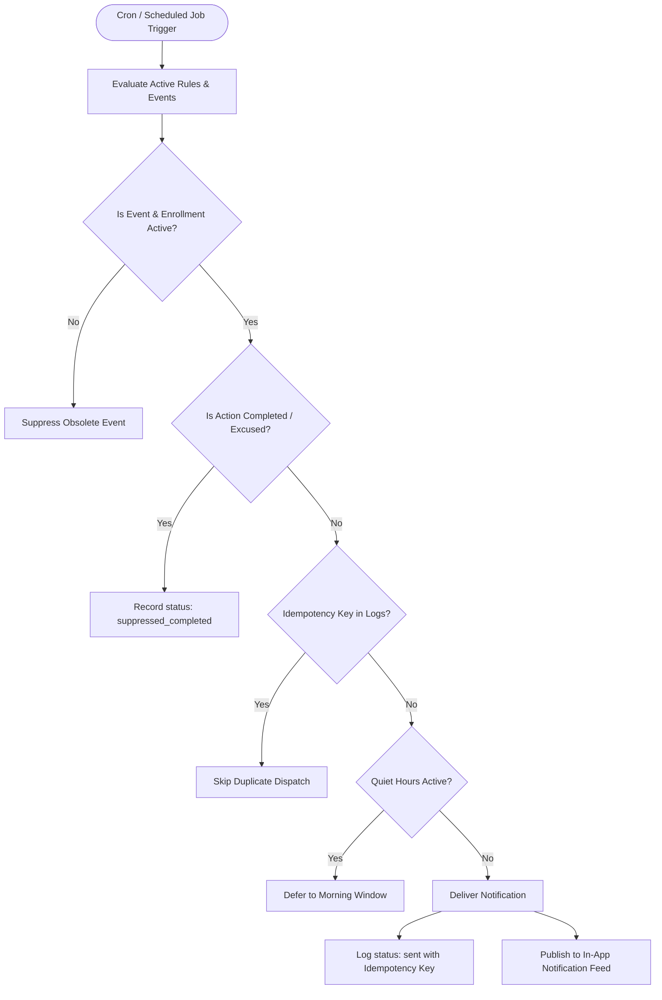

# Smart Reminders & Notifications System Specification
**Project:** GDG on Campus NCTU HR Management Platform  
**Subsystem:** Technical Tracks Management — Intelligent Reminders & Notification Engine  
**Status:** Implemented & Fully Operational  

---

## 1. Objective & Overview
The Smart Reminders & Notifications module provides an intelligent, configurable reminder system that helps participants stay on schedule and assists instructors and HR members in tracking critical milestones without intrusive spam or duplicated notifications.

Key capabilities:
- **Contextual Reminders:** Upcoming sessions, approaching assignment deadlines (72h, 24h, 3h), overdue assignments, reviews awaiting grading, revision requests, resubmission deadlines, and at-risk follow-up actions.
- **Idempotency & Deduplication:** Background evaluation generates unique idempotency keys (`rem_{rule_id}_{event_id}_{recipient_id}_{offset}`) preventing duplicate notification dispatch across repeated background worker runs.
- **Intelligent Suppression:** Automatically suppresses scheduled notifications if the participant has already submitted, if the assignment was cancelled, or if an official excuse was granted.
- **In-App Notification Center:** Filterable by category (`all`, `unread`, `assignments`, `sessions`, `feedback`, `follow_ups`, `admin`) with real-time badge counts and direct resource deep-linking.
- **Provider Agnostic Extensibility:** Designed for in-app delivery with server-side email dispatch support via cron/webhooks (`CRON_SECRET` authorized).

---

## 2. Configurable Reminder Policies

| Rule ID | Reminder Type | Offset | Recipient Role | Default Message Template (EN / AR) | Channel |
|---|---|---|---|---|---|
| `rule_asg_72h` | `upcoming_deadline` | -72 hours | Participant | "Assignment deadline approaching in 72 hours for '{title}'." / "تنبيه: يتبقى 72 ساعة على تسليم المهمة '{title}'." | In-App |
| `rule_asg_24h` | `upcoming_deadline` | -24 hours | Participant | "Assignment '{title}' is due in 24 hours. Don't forget to push your code!" / "تذكير: يتبقى 24 ساعة فقط على موعد تسليم '{title}'." | In-App |
| `rule_asg_3h` | `upcoming_deadline` | -3 hours | Participant | "Urgent: Final 3 hours remaining to submit '{title}'." / "تنبيه عاجل: يتبقى 3 ساعات فقط على إغلاق موعد تسليم '{title}'." | In-App |
| `rule_asg_overdue` | `overdue_assignment` | +1 hour | Participant | "Assignment '{title}' is now overdue. Submit as soon as possible." / "المهمة '{title}' متأخرة عن الموعد النهائي. يرجى المسارعة بالتسليم." | In-App |
| `rule_sess_24h` | `upcoming_session` | -24 hours | Participant | "Upcoming Session: '{title}' is scheduled tomorrow at {time}." / "تذكير: الجلسة التقنية '{title}' غداً في تمام الساعة {time}." | In-App |
| `rule_resubmit_req` | `feedback_resubmission_requested` | Immediate | Participant | "Revision requested on '{title}'. Please check notes and resubmit before deadline." / "طلب مراجع المسار تعديلات على تسليمك للمهمة '{title}'." | In-App |
| `rule_resubmit_24h` | `resubmission_deadline_approaching` | -24 hours | Participant | "Attention: Resubmission window for '{title}' closes in 24 hours." / "تنبيه: يتبقى 24 ساعة على انتهاء مهلة إعادة تسليم التعديلات." | In-App |
| `rule_grading_pending` | `assignment_awaiting_review` | +48 hours | Instructor | "Instructor Alert: Submission by {participant_name} for '{title}' is awaiting evaluation." / "تنبيه مدرب: تسليم المتدرب {participant_name} بانتظار التقييم." | In-App |
| `rule_risk_due` | `at_risk_follow_up_due` | -24 hours | Follow-up Owner | "Support Case Alert: Follow-up action for {participant_name} is due tomorrow." / "تنبيه متابعة: موعد جلسة الدعم للمتدرب {participant_name} يحل غداً." | In-App |

---

## 3. Smart Reminder Lifecycle & State Flow



---

## 4. In-App Notification Center Architecture
Located in the global header (`src/components/layout/header.tsx`), the notification feed combines:
1. **Track Notifications:** Generated by `tracksService` for technical tracks participants and instructors.
2. **Administrative Task Reminders:** Derived from core team assignments.
3. **Category Pills:** Multi-category filtering:
   - `All` (جميع الإشعارات)
   - `Unread` (غير المقروء)
   - `Assignments` (المهام والتسليمات)
   - `Sessions` (الجلسات والحضور)
   - `Feedback` (الملاحظات والدرجات)
   - `Follow-ups` (المتابعة والدعم الأكاديمي)
   - `Admin` (التكليفات الإدارية)
4. **Mark as Read:** Individual click acknowledgment and "Mark All as Read" batch action.

---

## 5. Server-Side Background Scheduled Job
The background scheduling endpoint is located at `src/app/api/reminders/process/route.ts`.
- **Method:** `GET` / `POST`
- **Security:** Requires `Authorization: Bearer <CRON_SECRET>` or `x-cron-secret` header.
- **Payload Response:**
```json
{
  "success": true,
  "timestamp": "2026-10-12T05:30:00.000Z",
  "generatedCount": 4,
  "suppressedCount": 2,
  "totalProcessedLogs": 18
}
```
- **Deployment Compatibility:** Vercel Cron (`vercel.json`), GitHub Actions Scheduled Workflow, or external cron pingers.
