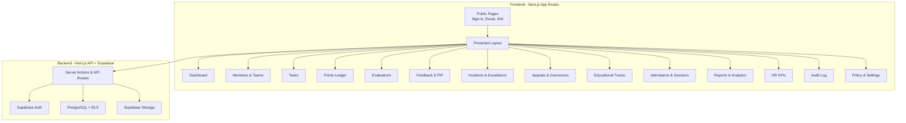
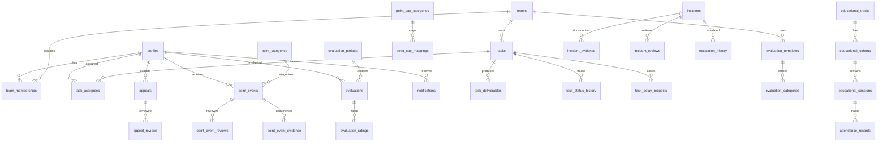

# 🏗️ GDG NCTU HR Management & Performance Platform — Implementation Plan

## 📋 Project Overview

**Project:** GDG on Campus — New Cairo Technological University HR Management Platform  
**Goal:** Replace scattered spreadsheets with a centralized, transparent, auditable HR operations and member performance platform.

---

## 🧰 Technology Stack

| Layer | Technology |
|---|---|
| **Framework** | Next.js 14+ (App Router) |
| **Language** | TypeScript (strict mode) |
| **UI** | React + Tailwind CSS + shadcn/ui |
| **Icons** | Lucide React |
| **Database** | PostgreSQL (via Supabase) |
| **Auth** | Supabase Auth |
| **Authorization** | PostgreSQL RLS + Server-side checks |
| **Forms** | React Hook Form + Zod |
| **Tables** | TanStack Table |
| **Charts** | Recharts |
| **Dates** | date-fns with timezone support |
| **Testing** | Vitest + React Testing Library + Playwright |
| **Deployment** | Vercel + Supabase |
| **i18n** | next-intl (Arabic RTL + English LTR) |

---

## 🔑 Key Design Decisions

> [!IMPORTANT]
> These decisions are derived directly from the official policy document and are **non-negotiable**.

1. **Positive/Negative points are SEPARATE from the Monthly Performance Score (out of 100)**
2. **Negative points NEVER automatically suspend/remove/expel a member**
3. **No automatic disciplinary penalty from numeric scores alone**
4. **Evidence + Review + Member Notification required before penalties**
5. **Full audit trail on all consequential actions**
6. **Serious violations → Investigation referral (NOT a fixed numeric penalty)**
7. **Points balance calculated from approved ledger records, never manually editable**

---

## 📐 Architecture Overview



---

## 🗄️ Database Schema (50+ Tables)



### Core Tables Summary

| Group | Tables | Count |
|---|---|---|
| **User & Auth** | profiles, user_roles, permissions | 3 |
| **Organization** | teams, team_memberships, membership_history | 3 |
| **Tasks** | tasks, task_assignees, task_deliverables, task_status_history, task_delay_requests | 5 |
| **Points** | point_categories, point_cap_categories, point_cap_mappings, point_events, point_event_evidence, point_event_reviews | 6 |
| **Evaluations** | evaluation_templates, evaluation_template_versions, evaluation_categories, evaluation_periods, evaluations, evaluation_ratings, evaluation_evidence, evaluation_review_history | 8 |
| **Feedback & PIP** | feedback_sessions, feedback_action_items, improvement_plans | 3 |
| **Incidents** | incidents, incident_evidence, incident_reviews, escalation_history | 4 |
| **Appeals** | appeals, appeal_reviews | 2 |
| **Education** | educational_tracks, educational_cohorts, educational_sessions, attendees, attendee_evaluations, instructor_evaluations, mentor_evaluations | 7 |
| **Events & Attendance** | events, attendance_records | 2 |
| **Notifications** | notifications, notification_preferences | 2 |
| **Policy** | policy_versions, policy_settings | 2 |
| **System** | audit_logs, import_jobs, application_settings | 3 |
| **Total** | | **50** |

---

## 👥 User Roles & Permissions

| Role | Scope |
|---|---|
| **Super Admin** | Global config, policy, user management, escalation review, org-wide reports |
| **HR Admin** | Member management, points review, evaluations, feedback, PIP, reports |
| **HR Reviewer** | Review evidence, approve/reject assigned cases only |
| **Team Lead** | Team members, tasks, point recommendations, evaluations, team reports |
| **Member** | Own profile, tasks, points view, evaluations view, appeals |
| **Track Lead** | Educational track management |
| **Lead Instructor** | Session management, attendee evaluation |
| **TA/Mentor** | Assist attendees, limited evaluation access |
| **Attendee** | View own educational records |

> [!WARNING]
> All permissions are enforced server-side via RLS + middleware. Frontend visibility is secondary.

---

## 🚀 Implementation Phases

### Phase 1 — Inspect & Setup ⏱️ ~1 hour
- [x] Read the full prompt/policy document
- [x] Initialize Next.js project with App Router
- [x] Configure TypeScript strict mode
- [x] Install and configure all dependencies
- [x] Set up Tailwind CSS + shadcn/ui
- [x] Set up next-intl for Arabic/English
- [x] Create `.env.example` with all required variables
- [x] Set up project folder structure

### Phase 2 — Architecture & Foundation ⏱️ ~3 hours
- [x] Create complete database migration files (50+ tables)
- [x] Define all TypeScript types and Zod schemas
- [x] Create Supabase client utilities (browser + server)
- [x] Build RLS policies for all tables
- [x] Create seed data script with fictional members/teams
- [x] Set up audit logging infrastructure
- [x] Configure middleware for auth + role checking

### Phase 3 — Design System & Layout ⏱️ ~2 hours
- [x] Build the global layout with sidebar navigation (15 items)
- [x] Implement responsive sidebar (desktop/tablet/mobile)
- [x] Create language switcher (AR ↔ EN)
- [x] Implement RTL/LTR layout switching
- [x] Build reusable components:
  - DataTable & Cards
  - StatusBadge (Draft/Pending/Approved/Rejected)
  - Dialog / Modals
  - PageHeader with breadcrumbs
  - EmptyState, LoadingState
  - SearchInput with filters
  - StatsCard with GDG accent bars
- [x] Set up Google-inspired color system (blue/red/yellow/green accents)
- [x] Configure typography and dark/light themes

### Phase 4 — Authentication ⏱️ ~1 hour
- [x] Sign-in page
- [x] Password reset flow
- [x] Protected route middleware
- [x] Session management
- [x] Unauthorized access page (403)
- [x] Not-found page (404)
- [x] Role-aware redirects

### Phase 5 — Members & Teams Module ⏱️ ~3 hours
- [x] Member directory with search, filter, sort, pagination
- [x] Create/Edit member forms with Zod validation
- [x] Member detail page with tabs:
  - Profile info
  - Membership history
  - Task history
  - Points ledger
  - Evaluation history
  - Feedback sessions
  - Incidents & Appeals
- [x] Team directory
- [x] Team detail with member list
- [x] Team Lead assignment
- [x] CSV/XLSX import with:
  - File validation
  - Column mapping
  - Preview
  - Duplicate detection
  - Confirmation
  - Import summary
- [x] Bulk export

### Phase 6 — Task Management Module ⏱️ ~3 hours
- [x] Task list with filters (status, team, assignee, priority, deadline)
- [x] Create/Edit task form
- [x] Task detail page with:
  - Info, deliverables, acceptance criteria
  - Status timeline (Draft → Assigned → In Progress → ... → Completed)
  - Evidence links
  - Review comments
- [x] Assign members to tasks
- [x] Submit deliverables workflow
- [x] Review submissions (approve/request revision)
- [x] Delay request workflow (member → Team Lead)
- [x] Immutable task status history
- [x] Backend status transition enforcement

### Phase 7 — Points Ledger Module ⏱️ ~4 hours

> [!IMPORTANT]
> This is one of the most critical modules. Must follow policy exactly.

- [x] Points ledger table with all mandatory fields (20+ fields per record)
- [x] New point recommendation form
- [x] Evidence upload/linking
- [x] Workflow: Draft → Submitted → Pending Review → Approved/Rejected
- [x] Member notification before negative point approval
- [x] Member explanation submission
- [x] Review queue for HR Reviewers
- [x] Duplicate-event protection
- [x] Monthly positive-point cap enforcement (7 categories)
- [x] Policy-mapping layer for cap categories
- [x] Ambiguous mapping flagging
- [x] Remaining cap display per category per member
- [x] Approved balance calculation from ledger (not editable field)
- [x] Pending vs Approved display separation
- [x] Net-point classification (Green/Normal/Warning/Red)
- [x] Serious violations → Investigation referral (no numeric penalty)
- [x] Corrections as auditable reversals (not history erasure)
- [x] Policy version tracking per approved record

### Phase 8 — Monthly Evaluations Module ⏱️ ~4 hours
- [x] Evaluation periods management (open/close)
- [x] 6-category evaluation form with exact weights:
  - Task Completion (30)
  - Quality & Standards (25)
  - Reliability (15)
  - Knowledge Sharing (10)
  - Documentation (10)
  - Growth & Initiative (10)
- [x] Rating 1-5 per category
- [x] Score calculation: `(Rating/5) × Weight`
- [x] N/A handling with proportional recalculation
- [x] All-N/A → "Not Evaluated" (not zero)
- [x] Performance bands (Outstanding/Strong/Needs Improvement/Coaching)
- [x] Decimal-safe calculations with documented rounding
- [x] Evaluation workflow:
  - Period opened
  - Self-assessment (optional)
  - Team Lead rates
  - System validates
  - HR reviews
  - Finalization
  - Member notification
  - Feedback scheduling
- [x] Draft/Submitted/Under Review/Finalized/Reopened states
- [x] Amendment process for finalized evaluations (with audit)
- [x] Team-specific criteria templates (HR, PR, OR, Media, Tech tracks)

### Phase 9 — Feedback & PIP Module ⏱️ ~2 hours
- [x] Feedback calendar view
- [x] Create feedback session (strengths, improvement, next steps, support, follow-up)
- [x] Private HR notes vs member-visible feedback
- [x] PIP management:
  - Specific concern + evidence
  - Agreed actions + support
  - Start/target dates
  - Follow-up schedule
  - Progress tracking
  - Outcome & closure
- [x] Development action items tracking

### Phase 10 — Incidents & Escalations Module ⏱️ ~3 hours
- [x] Incident creation with evidence
- [x] 4-level escalation workflow:
  - Level 1: Friendly Warning
  - Level 2: PIP
  - Level 3: Team Review
  - Level 4: Leadership Escalation
- [x] Evidence management (restricted access)
- [x] Review and decision recording
- [x] Case history timeline
- [x] Restricted access for sensitive cases
- [x] No automatic escalation from points alone

### Phase 11 — Appeals & Grievances Module ⏱️ ~2 hours
- [x] Member appeal submission (linked to point/evaluation)
- [x] 7 working-day deadline calculation
- [x] Configurable working-day calendar
- [x] Deadline display with calculation explanation
- [x] Evidence attachment
- [x] Status workflow (Draft → Submitted → Under Review → ... → Closed)
- [x] Neutral reviewer assignment
- [x] Decision recording with rationale
- [x] Original decision preservation
- [x] Full audit trail

### Phase 12 — Attendance & Sessions Module ⏱️ ~2 hours
- [x] Event management (meetings, sessions, events)
- [x] Attendance recording
- [x] Absence notifications and explanations
- [x] Session recording links
- [x] Configurable response windows
- [x] Communication reference tracking
- [x] Academic/medical/emergency circumstance support

### Phase 13 — Educational Tracks Module ⏱️ ~3 hours
- [x] Track and cohort management
- [x] Session management
- [x] Attendee evaluation (100 pts):
  - Attendance & Punctuality (40)
  - Assignments & Projects (30)
  - Participation & Interaction (20)
  - Conduct & Collaboration (10)
- [x] Certificate eligibility (≥75%)
- [x] Lead Instructor evaluation (100 pts):
  - Punctuality (25)
  - Preparation & Quality (25)
  - Explanation & Interaction (25)
  - Student Follow-up (15)
  - Professionalism (10)
- [x] TA/Mentor evaluation (configurable criteria)
- [x] Educational tracks separate from monthly performance

### Phase 14 — Dashboards & Analytics ⏱️ ~3 hours
- [x] **HR Dashboard**: Total members, by team, tasks by status, overdue tasks, pending points, pending evaluations, open PIPs/appeals, performance distribution, trends
- [x] **Team Lead Dashboard**: Team members, tasks, completion rate, outstanding submissions, evaluation completion
- [x] **Member Dashboard**: Tasks, deadlines, points, evaluations, feedback, appeals, sessions
- [x] Charts with Recharts (bar, line, pie, area)
- [x] Analytics safeguards (label draft/pending/approved, define metrics, show period)

### Phase 15 — Reports & Exports ⏱️ ~2 hours
- [x] Organization overview report
- [x] Team performance reports
- [x] Monthly evaluation reports
- [x] Points reports
- [x] Feedback & PIP reports
- [x] Appeals reports
- [x] Educational reports
- [x] CSV/XLSX export with permission enforcement
- [x] Export audit logging
- [x] Filter by team, member, month, status, category

### Phase 16 — HR KPIs Module ⏱️ ~1 hour
- [x] 4 HR criteria (1-5 rating each):
  - Communication & Member Support
  - Confidentiality of Records
  - Member Integration & Follow-up
  - Fairness of Evaluation
- [x] Configurable weights (unweighted average as default)
- [x] System success indicators:
  - Task on-time delivery rate
  - Response acknowledgement rate
  - Warning frequency changes
  - Member performance improvement
  - Satisfaction survey results
- [x] Monthly history

### Phase 17 — Policy & Settings ⏱️ ~2 hours
- [x] Policy version management (immutable published versions)
- [x] Point categories and values configuration
- [x] Monthly cap configuration
- [x] Cap-category mappings
- [x] Net-point classification thresholds
- [x] Evaluation weights configuration
- [x] Team-specific criteria templates
- [x] Working-day calendar management
- [x] Notification preferences
- [x] Approval workflow configuration
- [x] Unresolved ambiguities screen
- [x] Prospective-only policy changes

### Phase 18 — Audit Log & Notifications ⏱️ ~2 hours
- [x] Audit log viewer with filters (actor, action, entity, date range)
- [x] Tamper-resistant audit records
- [x] In-app notification center
- [x] Notification bell with unread count
- [x] Configurable notification preferences
- [x] Deadline reminders
- [x] Secure notification content (no confidential details in plain text)

### Phase 19 — Testing ⏱️ ~3 hours
- [x] **Points system tests**: values, balance, caps, duplicates, corrections
- [x] **Evaluation tests**: weights, N/A, bands, max score
- [x] **Appeals tests**: deadline calculation, working days, access control
- [x] **Security tests**: member isolation, role enforcement, RLS
- [x] **Workflow tests**: task lifecycle, point lifecycle, evaluation lifecycle
- [x] Lint + Type check + Build verification

### Phase 20 — Handover ⏱️ ~1 hour
- [x] Complete `README.md` with:
  - Setup instructions
  - Environment variables guide
  - Database migration guide
  - Seed data instructions
  - Deployment guide
- [x] Feature implementation checklist
- [x] Security notes document
- [x] Unresolved policy ambiguities report

---

## ⏱️ Estimated Total Effort

| Phase | Hours |
|---|---|
| Phase 1: Inspect & Setup | ~1 |
| Phase 2: Architecture & Foundation | ~3 |
| Phase 3: Design System & Layout | ~2 |
| Phase 4: Authentication | ~1 |
| Phase 5: Members & Teams | ~3 |
| Phase 6: Task Management | ~3 |
| Phase 7: Points Ledger | ~4 |
| Phase 8: Monthly Evaluations | ~4 |
| Phase 9: Feedback & PIP | ~2 |
| Phase 10: Incidents & Escalations | ~3 |
| Phase 11: Appeals & Grievances | ~2 |
| Phase 12: Attendance & Sessions | ~2 |
| Phase 13: Educational Tracks | ~3 |
| Phase 14: Dashboards & Analytics | ~3 |
| Phase 15: Reports & Exports | ~2 |
| Phase 16: HR KPIs | ~1 |
| Phase 17: Policy & Settings | ~2 |
| Phase 18: Audit Log & Notifications | ~2 |
| Phase 19: Testing | ~3 |
| Phase 20: Handover | ~1 |
| **Total** | **~46 hours** |

---

## ⚠️ Known Policy Ambiguities to Flag

> [!WARNING]
> These items from the source policy require human decision-making before final implementation.

1. **Cap-Category Mapping Mismatch**: The policy's positive-point examples and its separate detailed point-event table are not perfectly aligned. Requires admin configuration.
2. **Non-Technical Team Criteria Weights**: Policy does not prescribe exact numeric weights for HR, PR, OR, Media team-specific criteria.
3. **Technical Track Criteria Weights**: No official weights for Web Dev, Flutter, UI/UX, Embedded, Cybersecurity specialized criteria.
4. **HR KPI Weights**: The 4 HR-specific criteria have no policy-defined weights.
5. **Working-Day Calendar**: No default calendar specified — must be configured by admin.
6. **Investigation Referral Penalty**: Serious violations have NO fixed numeric penalty — investigation referral only.
7. **WhatsApp Integration**: Must not be assumed — only if an authorized API is explicitly configured.
8. **Certificate Issuance Workflow**: Policy specifies eligibility at ≥75%, but actual issuance process is undefined.

---

## 📁 Proposed Project Structure

```
hr-management/
├── .env.example
├── next.config.ts
├── package.json
├── tsconfig.json
├── tailwind.config.ts
├── messages/
│   ├── en.json                    # English translations
│   └── ar.json                    # Arabic translations
├── supabase/
│   ├── migrations/                # SQL migration files
│   ├── seed.sql                   # Demo seed data
│   └── config.toml
├── src/
│   ├── app/
│   │   ├── [locale]/
│   │   │   ├── layout.tsx         # Root layout with i18n
│   │   │   ├── page.tsx           # Redirect to dashboard
│   │   │   ├── (auth)/
│   │   │   │   ├── sign-in/
│   │   │   │   └── reset-password/
│   │   │   ├── (protected)/
│   │   │   │   ├── layout.tsx     # Sidebar + nav
│   │   │   │   ├── dashboard/
│   │   │   │   ├── members/
│   │   │   │   ├── teams/
│   │   │   │   ├── tasks/
│   │   │   │   ├── points/
│   │   │   │   ├── evaluations/
│   │   │   │   ├── feedback/
│   │   │   │   ├── attendance/
│   │   │   │   ├── incidents/
│   │   │   │   ├── appeals/
│   │   │   │   ├── educational/
│   │   │   │   ├── hr-kpis/
│   │   │   │   ├── reports/
│   │   │   │   ├── audit-log/
│   │   │   │   └── settings/
│   │   │   └── not-found.tsx
│   │   └── api/                   # API routes
│   ├── components/
│   │   ├── ui/                    # shadcn/ui components
│   │   ├── layout/                # Sidebar, Header, Nav
│   │   ├── data-table/            # TanStack Table wrapper
│   │   └── shared/                # StatusBadge, EmptyState, etc.
│   ├── lib/
│   │   ├── supabase/              # Client utilities
│   │   ├── auth/                  # Auth helpers
│   │   ├── validators/            # Zod schemas
│   │   ├── calculations/          # Points, evaluations, deadlines
│   │   └── utils/                 # Helpers
│   ├── hooks/                     # Custom React hooks
│   ├── types/                     # TypeScript types
│   └── middleware.ts              # Auth + role middleware
├── tests/
│   ├── unit/                      # Vitest unit tests
│   ├── integration/               # Integration tests
│   └── e2e/                       # Playwright tests
└── docs/
    ├── setup.md
    ├── deployment.md
    ├── security.md
    └── policy-ambiguities.md
```

---

## ✅ Definition of Done Checklist

- [x] Working navigation system (15 sections)
- [x] Authentication works (or setup documented)
- [x] Server-side role enforcement (RLS + middleware)
- [x] Database migrations for 50+ tables
- [x] Member & team CRUD
- [x] Task assignment, submission, review workflow
- [x] Points ledger with correct balance calculation
- [x] Monthly cap enforcement with ambiguity handling
- [x] Monthly evaluation with N/A adjustment
- [x] Educational evaluations with official weights
- [x] Feedback, PIP, incidents, appeals workflows
- [x] Audit logs for all consequential changes
- [x] Reports & exports with permission enforcement
- [x] Form validation with useful errors
- [x] Automated tests for core business logic
- [x] Lint + Type-check + Build pass
- [x] Setup, migration, seed, deployment docs
- [x] No fake data in production workflows
- [x] Security assumptions documented
- [x] Policy ambiguities explicitly reported

