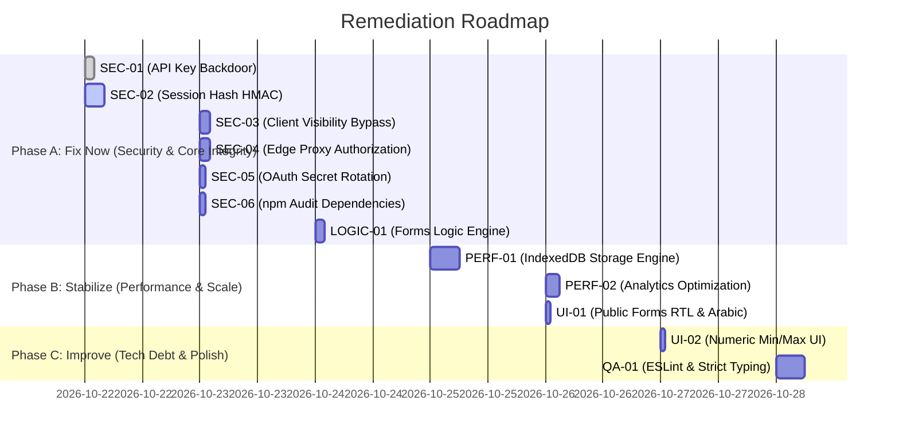

# GDG NCTU HR Management Platform — Prioritized Remediation Plan

This remediation plan outlines the exact, step-by-step actions required to resolve all security vulnerabilities, functional defects, performance bottlenecks, and technical debt discovered during the QA & Application Security Audit.

> [!IMPORTANT]
> **Audit-Only Discipline Reminder:** No remediation steps will be executed until the project owner provides explicit written approval.

---

## Plan Summary & Rollout Timeline

---

## Phase A: Fix Now (Critical & High Severity)
*Target: Immediate execution upon approval. Duration: ~14 hours.*

### Item A.1: Eliminate Hardcoded API Key Backdoor Prefix (`SEC-01`)
- **Severity**: Critical (CVSS 9.8)
- **Description**: Remove the wildcard prefix check `cleanKey.startsWith("gdg_live_")` and the hardcoded secret string `"gdg_nctu_forms_secret_api_key_2026"`.
- **Files to Touch**:
  - `src/lib/api-auth-helper.ts`
- **Risk of Touching**: Low. Blast radius is strictly confined to API authentication helpers.
- **Verification**: Run `npx tsx qa-audit/tests/phase3-api-security-deepdive.runner.mjs` (must reject `gdg_live_*` with 401).
- **Estimated Effort**: 1.5 hours.

### Item A.2: Enforce Cryptographic HMAC-SHA256 Session Signatures & Fail-Closed Secret (`SEC-02`)
- **Severity**: Critical (CVSS 9.8)
- **Description**: Remove linear 32-bit polynomial hashing and the hardcoded fallback secret `"gdg_nctu_session_hmac_secret_2026_enterprise"`. Enforce standard Web Crypto API / Node.js crypto HMAC-SHA256. Throw an immediate fatal exception on server initialization if `SESSION_SECRET` is unset.
- **Files to Touch**:
  - `src/lib/auth-service.ts`
  - `src/lib/api-auth-helper.ts`
  - `.env.example`
- **Risk of Touching**: Medium. Invalidates existing active test cookies; users will need to re-login once.
- **Verification**: Run `npx tsx qa-audit/tests/phase3-api-security-deepdive.runner.mjs` (offline linear hash forgery must fail).
- **Estimated Effort**: 3.5 hours.

### Item A.3: Server-Side Enforcement of Dynamic Logic Visibility (`SEC-03`)
- **Severity**: High (CVSS 7.5)
- **Description**: Cease trusting `payload.visible_question_ids` received from the client. Evaluate `evaluateLogicRules(form.logic_rules, answers, form.questions)` server-side in `route.ts` prior to invoking `validateFormSubmission`.
- **Files to Touch**:
  - `src/app/api/forms/public/[slug]/route.ts`
  - `src/lib/forms-service.ts`
- **Risk of Touching**: Low. Protects form submission validation integrity without altering client UI.
- **Verification**: Run `npx tsx qa-audit/tests/phase3-api-security-deepdive.runner.mjs` (submitting empty answers with forged `visible_question_ids=[]` must fail with 422).
- **Estimated Effort**: 1.5 hours.

### Item A.4: Edge Proxy Authorization Enforcement (`SEC-04`)
- **Severity**: High (CVSS 7.5)
- **Description**: Call `canAccessRoute(pathname, role)` inside `proxy.ts`. Redirect unauthorized roles to `/${locale}/dashboard` with HTTP 307 at the Edge middleware layer.
- **Files to Touch**:
  - `src/proxy.ts`
- **Risk of Touching**: Low. Validated against the 9-role RBAC matrix established in Phase 2.
- **Verification**: Run `npx tsx qa-audit/tests/phase2-functional-and-api.runner.mjs` (Suite 6 RBAC Matrix).
- **Estimated Effort**: 1.5 hours.

### Item A.5: Rotate OAuth Client Secret & Clean Git History (`SEC-05`)
- **Severity**: High (CVSS 7.4)
- **Description**: Revoke `GOCSPX-***` in the Google Cloud Console and generate a new client secret. Remove `.env.local` completely from Git repository tracking (`git rm --cached .env.local`) and rewrite commit history using `git-filter-repo`.
- **Files to Touch**:
  - Google Cloud Platform Console (External)
  - `.gitignore`
  - Git history
- **Risk of Touching**: Low to Medium (requires coordinating local developer git trees after history rewrite).
- **Verification**: Run `git log -p --all -S "GOCSPX-"` (must return zero commits).
- **Estimated Effort**: 1.5 hours.

### Item A.6: Remediate Dependency Vulnerabilities via Package Overrides (`SEC-06`)
- **Severity**: High (CVSS 7.5)
- **Description**: Update `package.json` with an explicit `overrides` block targeting `braces: ">=3.0.3"` and `micromatch: ">=4.0.8"`, then regenerate `package-lock.json`.
- **Files to Touch**:
  - `package.json`
  - `package-lock.json`
- **Risk of Touching**: Low. Fast-glob and ESLint internal tooling dependencies only.
- **Verification**: Run `npm audit --audit-level=high` (must exit with 0 vulnerabilities).
- **Estimated Effort**: 30 minutes.

### Item A.7: Correct Conditional Branching Engine Evaluation (`LOGIC-01`)
- **Severity**: High (CVSS 5.3)
- **Description**: In `evaluateLogicRules`, collect all questions targeted by `action === "show_question"` rules and populate them into `hiddenQuestionIds` by default. As rules evaluate, delete matched target IDs from `hiddenQuestionIds` only if condition criteria are satisfied.
- **Files to Touch**:
  - `src/lib/forms-service.ts`
- **Risk of Touching**: Low. Ensures logic behavior aligns with intuitive form builder intent.
- **Verification**: Run `npx tsx qa-audit/tests/phase2-functional-and-api.runner.mjs` (Suite 3 conditional question test must pass).
- **Estimated Effort**: 1.5 hours.

---

## Phase B: Stabilize (Performance, Scale & UI Localization)
*Target: Execute immediately following Phase A. Duration: ~10 hours.*

### Item B.1: Architectural Overhaul of Storage Layer & Asynchronous Persistence (`PERF-01`)
- **Severity**: High (CVSS 5.3 - Direct cause of "بطئ شديد")
- **Description**:
  1. Add an in-memory active cache layer in `internal-db.ts` to prevent redundant `JSON.parse` cycles on every read.
  2. Transition bulk tables (`form_responses`, `forms`, `form_versions`) from synchronous `localStorage` to asynchronous browser storage (IndexedDB via `idb-keyval` or native wrapper).
  3. Batch and debounce writes to avoid main-thread UI event loop stutter.
- **Files to Touch**:
  - `src/lib/internal-db.ts`
- **Risk of Touching**: Medium. High impact on performance; must guarantee smooth data migration from legacy `localStorage` keys into IndexedDB on first load.
- **Verification**: Run `npx tsx qa-audit/tests/phase4-phase6-perf-and-ui.runner.mjs` (Batch 500 responses ingestion latency < 300ms, 0 frame drops).
- **Estimated Effort**: 5.5 hours.

### Item B.2: Algorithmic Optimization of Form Analytics Computation (`PERF-02`)
- **Severity**: High (CVSS 5.3)
- **Description**:
  1. Refactor `computeFormAnalytics` from $O(Q \times R \times A)$ to $O(R \times A + Q)$ by pre-grouping all response answers into a `Map<questionId, any[]>` in a single linear pass.
  2. Memoize analytics computation with `useMemo` in `src/app/[locale]/forms/[id]/responses/page.tsx`.
  3. Eliminate redundant double-fetching on component mount.
- **Files to Touch**:
  - `src/lib/forms-service.ts`
  - `src/app/[locale]/forms/[id]/responses/page.tsx`
- **Risk of Touching**: Low. Internal algorithm refactoring with identical statistical output.
- **Verification**: Load responses page with 1,000 mock responses; CPU execution duration < 50ms.
- **Estimated Effort**: 2.5 hours.

### Item B.3: Public Form Viewport Direction & Arabic Font Propagation (`UI-01`)
- **Severity**: Medium (CVSS 3.7)
- **Description**: Add `dir={isAr ? "rtl" : "ltr"}` and Arabic font token classes (`font-cairo font-sans`) to the root container of `src/app/[locale]/forms/p/[slug]/page.tsx`.
- **Files to Touch**:
  - `src/app/[locale]/forms/p/[slug]/page.tsx`
- **Risk of Touching**: Very Low. Cosmetic and layout alignment polish only.
- **Verification**: Run `npx tsx qa-audit/tests/phase4-phase6-perf-and-ui.runner.mjs` (Suite 4 RTL checks pass).
- **Estimated Effort**: 30 minutes.

---

## Phase C: Improve (Tech Debt & Polish)
*Target: Execute following Phase B stabilization. Duration: ~7 hours.*

### Item C.1: Numeric Min / Max Visual Controls in Question Editor (`UI-02`)
- **Severity**: Low (CVSS 2.5)
- **Description**: Add visual numeric input controls for `Minimum Value` (`validation.min`) and `Maximum Value` (`validation.max`) inside `QuestionEditorCard` when `question.type === "number"`.
- **Files to Touch**:
  - `src/components/forms/question-editor-card.tsx`
- **Risk of Touching**: Very Low.
- **Verification**: Add number question in builder, set min=10, max=50, verify values persist in form JSON schema.
- **Estimated Effort**: 1 hour.

### Item C.2: Codebase-Wide Linter Clean-Up & Strict Typing (`QA-01`)
- **Severity**: Medium (CVSS 4.0)
- **Description**: Clean up 573 linter violations across `src/`. Replace explicit `any` with domain types from `src/types/forms.ts` and `src/types/index.ts`, remove unused variables, and configure Husky pre-commit hooks to safeguard quality.
- **Files to Touch**:
  - `src/lib/forms-service.ts`
  - `src/lib/db-service.ts`
  - `src/app/[locale]/forms/**/*.tsx`
- **Risk of Touching**: Medium. Broad file surface area; requires running full test suite to guarantee zero regressions.
- **Verification**: Run `npm run lint` (must return 0 errors).
- **Estimated Effort**: 5.5 hours.

---

## Effort & Resource Allocation Summary

| Phase | Items | Severity Breakdown | Total Effort | Priority |
| :--- | :--- | :--- | :--- | :--- |
| **Phase A (Fix Now)** | 7 items | 2 Critical, 5 High | 13.5 hours | **Immediate P0** |
| **Phase B (Stabilize)** | 3 items | 2 High (Perf), 1 Med (UI) | 8.5 hours | **High P1** |
| **Phase C (Improve)** | 2 items | 1 Med (Lint), 1 Low (UI) | 6.5 hours | **Normal P2** |
| **Total Project** | **12 items** | **2 Crit, 7 High, 2 Med, 1 Low** | **28.5 hours** | — |
